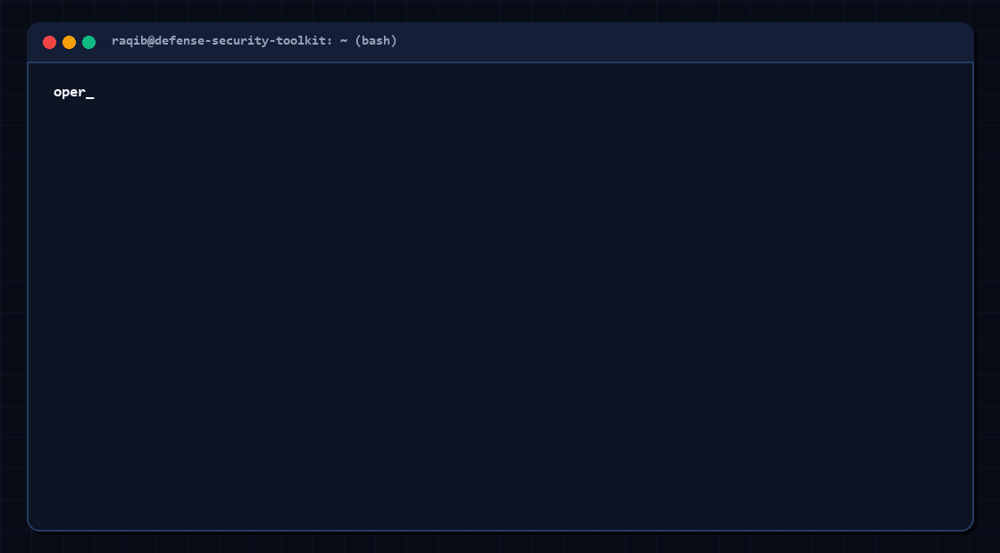
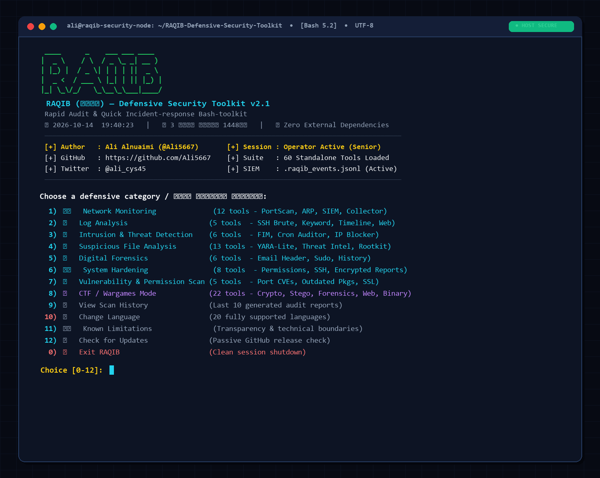

<div align="center">


<br/>



<br/>

# RAQIB (رقيب)
### Defensive Security Toolkit

**The only zero-dependency incident-response platform built entirely from scratch —  
96 standalone tools · 20 languages (100% complete) · real-time monitoring · CTF mode · threat intelligence**

[](LICENSE)
[](VERSION)
[](https://www.gnu.org/software/bash/)
[](https://python.org)
[](#-requirements)
[-brightgreen)](modules/lang.sh)
[](tools/)
[](CONTRIBUTING.md)

[Overview](#-overview) • [Demo](#-interactive-demo) • [Architecture](#-architecture) • [Quick Start](#-quick-start) • [Tools](#-tools--security-engines-96) • [New v2.2 Engines](#-new-in-raqib-v22-advanced-analytical--automation-engines) • [Rootkit Detector](#-rootkit-detector-guide) • [Email Header Analyzer](#-email-header-analyzer-guide) • [Samples & Testing](#-samples--testing-dataset-guide) • [Threat Intelligence](#-threat-intelligence) • [Accuracy](#-accuracy-benchmark) • [العربية](README.ar.md)

</div>

---

## 📖 Overview

**RAQIB** is a defensive security toolkit built for blue teams, incident responders, and security engineers who need *immediate, trustworthy results* — on hardened servers with nothing extra installed.

Every single tool is written from scratch against core POSIX utilities (`ss`, `find`, `awk`, `grep`, `openssl`, `/dev/tcp`, `python3` stdlib). No Nmap. No Wireshark. No third-party security binaries. Just clean, auditable code that runs on a minimal Alpine container or a fully-locked-down box.

96 tools across 8 operational domains (including 24 specialized CTF & Wargames tools), **wired together as one integrated incident-response workflow** — not a pile of disconnected scripts.

> ⚠️ **Authorized use only.** Scanning tools are for *your own infrastructure* or systems you have explicit written authorization to assess.

---

## 🎥 Interactive Demo

The toolkit runs directly inside your terminal with an ASCII radar animation, audible eagle prompt (optional), operator authentication, and live security telemetry:

<div align="center">
  
  <br/>
  <sub><i>Figure: RAQIB terminal initialization, subsystem loading, and active defense monitoring.</i></sub>
</div>

### 🖥️ Main Menu Interface

<div align="center">
  
  <br/>
  <sub><i>Figure: RAQIB interactive terminal main menu showcasing 8 operational domains, CTF mode, and operator session.</i></sub>
</div>

---

## ✨ Why RAQIB

<table>
<tr><td width="32">🚫</td><td><b>Zero external tool dependency</b><br>Runs on a fresh minimal Linux install. No apt install, no pip install, no external security binaries. Every check is written from scratch on POSIX primitives.</td></tr>
<tr><td>🧬</td><td><b>Composite malware detection — the YARA-lite engine</b><br>Scores multiple weak signals together: string concatenation, <code>chr()</code> obfuscation, hex escapes, PHP-in-image polyglots, Base64-encoded ELF blobs — instead of one brittle signature. Layers a real <code>yara</code> binary automatically if installed. F1 score: <b>98.5%</b>.</td></tr>
<tr><td>🧠</td><td><b>Local Threat Intelligence Engine</b><br>Builds and queries a local IOC database (IPs, domains, URLs, hashes) from Feodo Tracker, URLhaus, and CISA KEV — completely offline at query time. Auto-consulted by 6 other tools transparently.</td></tr>
<tr><td>📡</td><td><b>Real-time watchdog + multi-host aggregation</b><br>Background daemon monitors all 7 detection categories. Alerts via Telegram. Forwards structured JSON events to a central collector server on another machine for fleet-wide monitoring.</td></tr>
<tr><td>📊</td><td><b>Built-in SIEM correlation engine</b><br>Correlates events from all tools into composite incidents using 4 rules: multi-tool clustering, repeat-critical, off-hours activity, and escalating severity patterns. Exports CEF format for Wazuh/Splunk/ELK.</td></tr>
<tr><td>🔐</td><td><b>AES-256-GCM encrypted reports</b><br>Every saved report can be encrypted with AES-256-GCM + Argon2id KDF (memory-hard, GPU-resistant) in one keystroke. Self-describing format: old reports (Scrypt) remain decryptable forever.</td></tr>
<tr><td>🏴</td><td><b>Complete CTF / Wargames mode</b><br>22 purpose-built tools across Crypto, Stego, Forensics, Web, and Binary — from Vigenère cracking to ELF analysis to PCAP parsing. Flag Hunter + Writeup Logger included.</td></tr>
<tr><td>👤</td><td><b>Operator identity + approval workflow</b><br>PBKDF2 hashed operator accounts. Two roles (analyst/senior). Every destructive action goes through a pending-approval queue reviewable by senior operators only.</td></tr>
<tr><td>🌍</td><td><b>20 languages, 505 strings each</b><br>Every message, prompt, error, and report — fully translated. Missing string? The optional LibreTranslate bridge fills it live and caches locally.</td></tr>
<tr><td>📈</td><td><b>Honest accuracy benchmark</b><br><code>tests/run_accuracy_eval.sh</code> imports the actual detection code and reports Precision/Recall/F1 against a manually-labeled adversarial corpus.</td></tr>
</table>

---

## 🏗️ Architecture

```
raqib/
├── raqib.sh                             ← Main entry: auth, menu routing, live clock daemon
├── VERSION · update_source.txt          ← Self-update checker (disabled until you enable it)
├── README.md / README.ar.md             ← Full documentation (EN + AR)
├── LICENSE · SECURITY.md · CONTRIBUTING.md · CHANGES.md
│
├── modules/                             ← Shared kernel (sourced by every tool)
│   ├── common.sh                        ← Shared core library:
│   │                                       • AES-256-GCM encryption/decryption (Argon2id + Scrypt)
│   │                                       • Structured JSON event log (SIEM-compatible)
│   │                                       • Telegram alerts (push on critical findings)
│   │                                       • Central collector forwarding (multi-host)
│   │                                       • Severity scoring + executive summary
│   │                                       • Operator identity + approval workflow
│   │                                       • Report ID + scan history (last 10)
│   │                                       • Cross-platform portability helpers
│   │                                       • Shared quarantine + secure-delete
│   │                                       • Multi-style Cyber Spinners (Braille/Radar/Pulse/Dots/Arrows)
│   │                                       • Smooth sub-block (1/8th Unicode) progress bars with live ETA
│   │                                       • Live single-line target scanner (draw_scan_line) & cyber flicker
│   │                                       • Universal cross-platform audio player (macOS/Linux/WSL/Windows)
│   ├── lang.sh                          ← 20×667 = 13,340 translation strings (100% complete)
│   ├── auto_translate.sh                ← Automated on-demand translation bridge
│   ├── update_translations.py           ← Python batch translation synchronizer (format specifier protection)
│   ├── raqib_updater.py                 ← Advanced toolkit updater & integrity manager (snapshots, rollback, verify)
│   └── lang_cache/                      ← Auto-translated strings (local, persistent)
│
├── assets/
│   ├── eagle_logo.txt / eagle_logo_2.txt  ← ASCII art (radar-scan terminal banner)
│   ├── eagle_cry_real.wav               ← Startup sound (afplay / pw-play / paplay / aplay / powershell)
│   └── raqib_demo.gif                   ← Animated terminal demo for documentation
│
├── samples/                             ← Synthetic test logs and binaries
│   ├── README_samples.md                ← [MD File] Samples usage guide & test scenarios
│   ├── sample_auth.log                  ← Synthetic authentication logs (SSH / brute-force)
│   ├── sample_access.log                ← Synthetic HTTP server access log (web attacks)
│   └── sample_suspicious_binary.bin     ← Synthetic high-entropy test binary
│
├── tests/
│   ├── run_accuracy_eval.sh             ← Precision/Recall/F1 benchmark (F1=98.5%)
│   └── corpus/                          ← Adversarial test corpus
│
└── tools/
    ├── monitoring/ (16)                 ← Network + SIEM + alerting + Prometheus exporter
    ├── logs/       (6)                  ← Log analysis, parsing & statistical anomaly detection
    ├── ids_ips/    (8)                  ← Intrusion detection, TLS C2 fingerprinting & rate limiting
    ├── malware/    (17)                 ← Static analysis, ML classification, Sigma rules & threat intel
    │   ├── rootkit_detector.md          ← [MD File] Complete Rootkit Detector documentation
    │   ├── rootkit_detector.sh          ← Rootkit Scanner (kernel/proc/memfd/eBPF/preload)
    │   ├── ml_classifier.py             ← Pure-Python ML Classifier (Decision Tree + Naive Bayes)
    │   ├── sigma_translator.py          ← Sigma YAML rule translator to regex & YARA-lite
    │   ├── resources/rootkit/           ← Detection resource lists
    │   └── rules/                       ← Rules and feeds
    │
    ├── forensics/  (7)                  ← Digital forensics, live memory carving & email analysis
    │   ├── advanced_forensics.sh        ← Live memory carving, process lineage & binary verification
    │   ├── email_header_analyzer.md     ← [MD File] Complete Email Header Analyzer documentation
    │   ├── email_header_analyzer.py     ← Email spoofing/phishing header triage engine
    │   └── resources/email/             ← Detection resource lists
    │
    ├── hardening/  (9)                  ← System hardening, CIS Benchmark auditing & audit trail
    ├── vuln_scan/  (9)                  ← Vulnerability, secrets & Git history scanning
    └── ctf/        (24)                 ← CTF / Wargames mode (Crypto/Stego/Forensics/Web/Binary)
```

---

## ⚙️ Quick Start

```bash
# Clone
git clone https://github.com/Ali5667/RAQIB-Defensive-Security-Toolkit.git
cd RAQIB-Defensive-Security-Toolkit

# Run (Bash 4+ required — see note for macOS)
chmod +x raqib.sh
./raqib.sh

# macOS: brew install bash && /opt/homebrew/bin/bash raqib.sh
```

### Requirements

| Requirement | Notes |
|---|---|
| **Bash 4+** | macOS ships with Bash 3 — `brew install bash` |
| **Python 3.8+** | For entropy, intelligence engine, encryption, SIEM export |
| `find`, `awk`, `grep`, `ss`, `openssl` | Core utilities — present on any Linux |
| `curl` *(optional)* | Reputation checks, rule updates, Telegram alerts |
| `yara` *(optional)* | Real YARA rule layer on top of the YARA-lite engine |
| `afplay`/`pw-play`/`paplay`/`aplay`/`powershell` *(optional)* | Eagle startup sound (macOS, PipeWire, PulseAudio, ALSA, Windows/WSL) |
| `python3 cryptography` *(optional)* | Report encryption (AES-256-GCM) |

---

## 📋 Tools & Security Engines (96)

> **Architecture Overview**: RAQIB provides **96 total security tools, analytical engines, and daemons** — 72 core defensive incident-response & audit tools distributed across 7 primary categories, plus 24 dedicated CTF & competition tools.

### 🛰️ Network Monitoring (13)

| # | Tool | Description |
|---|---|---|
| 1 | **Port Scanner** | TCP port range scan via `/dev/tcp` — no Nmap |
| 2 | **Active Connections** | Live network connections via `ss`, mapped to processes |
| 3 | **Bandwidth Monitor** | Real-time upload/download rate from `/sys/class/net` |
| 4 | **ARP Watch** | ARP table baseline + change detection (ARP spoofing alerts) |
| 5 | **DNS Lookup** | Forward/reverse lookups via Python sockets — no `dig` required |
| 6 | **Ping Sweep** | Live host discovery across a subnet (validated octet ranges) |
| 7 | **SIEM Correlator** | Correlates all tool events into composite incidents (4 rules) + CEF export |
| 8 | **Telegram Setup** | Configure Telegram Bot push alerts for critical findings |
| 9 | **Dashboard Generator** | Self-contained HTML dashboard (offline-capable, no CDN) |
| 10 | **Watchdog Setup** | Background daemon that continuously monitors all 7 categories |
| 11 | **Collector Server** | Central JSON event aggregator for multi-host fleet monitoring |
| 12 | **Collector Client Setup** | Configure a host to forward its events to the collector |
| 13 | **Multi-Channel Alerter** | Unified webhook alerts (Discord/Slack/Teams/Telegram) + SQLite event store + Prometheus `/metrics` exporter |

### 📋 Log Analysis (6)

| # | Tool | Description |
|---|---|---|
| 1 | **Failed SSH Report** | Ranks attacking IPs by failed-login count from auth.log |
| 2 | **Log Keyword Search** | Context-aware search with surrounding lines |
| 3 | **Top Repeated Lines** | Surfaces recurring error patterns via frequency analysis |
| 4 | **Log Timeline** | Extracts events within an arbitrary time window |
| 5 | **Web Access Analyzer** | Top IPs, status codes, most-requested paths from access logs |
| 6 | **Log Anomaly Detector** | Statistical Z-score spike detection (>3σ) + parsers for Nginx, Apache, Traefik, Docker JSON, Kubernetes audit + SQLi/XSS/Command Injection detection |

### 🚨 Intrusion Detection (8)

| # | Tool | Description |
|---|---|---|
| 1 | **Brute Force Detector** | Configurable threshold alert on per-IP failed attempts |
| 2 | **Listening Ports Auditor** | Maps every open port to its owning process (`ss`/`lsof`) |
| 3 | **File Integrity Monitor** | SHA256 baseline creation + delta detection |
| 4 | **Cron Auditor** | Flags recently-modified cron jobs across all users |
| 5 | **Connection Rate Watcher** | Two-snapshot delta to catch sudden connection spikes |
| 6 | **IP Blocker** | UFW/iptables/nftables rule insertion with audit logging |
| 7 | **TLS Fingerprint Detector** | JA3/JA4 fingerprinting from TLS Client Hello packets to unmask C2 agents (Cobalt Strike, Sliver, Havoc, Metasploit) via PCAP or live capture |
| 8 | **Adaptive Rate Limiter** | Multi-tier defense (Warn → Limit → Tarpit → Block) with nftables/iptables integration & whitelist support |

### 🦠 Malware Analysis — Static (15)

| # | Tool | Description |
|---|---|---|
| 1 | **Hash Calculator** | MD5/SHA1/SHA256 — auto-offers reputation check on the result |
| 2 | **File Type Identifier** | Extension vs. real magic bytes (polyglot detection) |
| 3 | **Suspicious Strings Extractor** | IPs, URLs, Base64 blobs, dangerous shell commands |
| 4 | **Entropy Calculator** | Shannon entropy to spot packed/encrypted/compressed files |
| 5 | **Persistence Scanner** | systemd, cron, rc.local, LD_PRELOAD, ~/.profile |
| 6 | **Quarantine & Eradicate** | Hash-identical copy tracking + persistence cleanup + secure shred |
| 7 | **Auto Malware Cleaner** | Webshells + malicious cron + LD_PRELOAD + /tmp executables in one pass |
| 8 | **Hash Reputation Check** | VirusTotal API v3 + MalwareBazaar (abuse.ch) |
| 9 | **YARA-lite Scanner** | Updatable `name|weight|regex` engine — F1=98.5% on adversarial corpus |
| 10 | **Live Rules Updater** | Safe pull from your chosen source: format-validated, backed-up, local rules preserved |
| 11 | **Threat Intel Lookup** | Query and update local IOC database (Feodo/URLhaus/CISA KEV) — offline queries |
| 12 | **Unknown File Triage** | Weighted explainable heuristic scoring (6 signal types) — no ML, every point justified |
| 13 | **Rootkit Detector** | Hidden processes (`/proc` vs `ps`), memfd/temp execution, module hiding, LKM blocklists, `ld.so.preload`, altered binaries, eBPF kprobes |
| 14 | **ML Classifier** | Pure-Python lightweight weighted decision tree (16 calibrated features) + Gaussian Naive Bayes + baseline training with zero external dependencies |
| 15 | **Sigma Rule Translator** | Native pure-Python YAML parser translating Sigma detection rules into high-performance `grep -iE` queries & RAQIB YARA-lite rules |

### 🔍 Digital Forensics (7)

| # | Tool | Description |
|---|---|---|
| 1 | **Login History** | `last` / `lastb` / `lastlog` combined report |
| 2 | **Bash History Reviewer** | Searches every user's history for suspicious commands |
| 3 | **Filesystem Timeline** | Chronological ordering by mtime/ctime |
| 4 | **Disk Usage Snapshot** | Folder-size comparison between two points in time |
| 5 | **Sudo Log Review** | Every executed sudo command + failed sudo attempts |
| 6 | **Email Header Analyzer** | SPF/DKIM/DMARC verdicts, Received-chain anomaly analysis, From/Reply-To mismatches, Date skew, lure keywords |
| 7 | **Advanced Forensics Suite** | Live memory carving (`/proc/PID/mem`), process lineage & orphan tree analysis, and package manager binary integrity verification (`debsums/rpm -V`) |

### 🛡️ System Hardening (9)

| # | Tool | Description |
|---|---|---|
| 1 | **Permission Auditor** | World-writable files, SUID/SGID binaries |
| 2 | **SSH Config Auditor** | sshd_config vs. CIS/NIST best practices |
| 3 | **Service Lister** | Enabled services + alerts for risky ones (telnet, ftp, rsh) |
| 4 | **Password Policy Checker** | login.defs + PAM + no-password accounts |
| 5 | **Firewall Status Checker** | UFW/firewalld/iptables status and default policy |
| 6 | **Report Decryptor** | AES-256-GCM report decryption (RQBv1 + RQBv2 format support) |
| 7 | **Audit Log Viewer** | Structured event log browser — by operator, recent, pending |
| 8 | **Pending Actions Review** | Senior-only approval queue for destructive actions |
| 9 | **CIS Benchmark Auditor** | Comprehensive 20+ rule CIS compliance scoring (A-F grade) with 1-click automated remediation and rollback safety |

### 🎯 Vulnerability Scanning (6)

| # | Tool | Description |
|---|---|---|
| 1 | **Open Ports vs. Services** | Flags known-risky exposed ports with CVE context |
| 2 | **Outdated Packages** | apt/yum/pip outdated packages with severity hints |
| 3 | **Weak Permissions Scanner** | 777/666 files, world-readable SSH keys, SUID in unusual paths |
| 4 | **SSL Certificate Checker** | Expiry countdown + cipher suite + chain validation |
| 5 | **Default Credentials Scanner** | Weak/hardcoded passwords in configs and source files |
| 6 | **Secret & API Key Scanner** | High-entropy & 20+ credential leak patterns (AWS, GCP, GitHub, JWT, Keys) across files and Git commit history + local CISA KEV matching |

---

## 🏴 CTF / Wargames Mode (24 tools)

Launched from the main menu — a complete, self-contained toolkit for security competitions:

<details>
<summary><b>🔐 Cryptography (6)</b></summary>

| # | Tool | Capability |
|---|---|---|
| 1 | Codec Swiss Army | Base64/Hex/ROT13/ROT47/XOR-brute/Caesar/URL/Binary/Morse — auto-detect |
| 2 | Frequency Analysis | Character frequency + cipher-type identification |
| 3 | RSA Helper | Factoring (small primes) / e=3 attack / Wiener attack |
| 4 | Hash Identifier | MD5/SHA1/SHA256/bcrypt/NTLM/Argon2 pattern matching |
| 5 | Vigenère Cracker | Kasiski test + Index of Coincidence key recovery |
| 6 | Cipher Auto-Solver | Multi-layered automated cipher detector and solver (15+ encodings, double-encoding detection, XOR brute-force, English scoring) |
</details>

<details>
<summary><b>🖼️ Steganography (4)</b></summary>

| # | Tool | Capability |
|---|---|---|
| 7 | LSB Extractor | Bit-plane extraction from PNG/BMP — brute-tests 6 channel combos |
| 8 | Metadata Reader | EXIF parsing (no exiftool required) + hidden strings + steghide |
| 9 | Magic Bytes Check | Polyglot detection + extension spoofing identification |
| 10 | Audio Stego | Spectrogram (Sox) + Morse code detection + DTMF analysis |
</details>

<details>
<summary><b>🔍 Forensics (4)</b></summary>

| # | Tool | Capability |
|---|---|---|
| 11 | PCAP Analyzer | Protocol stats / HTTP extraction / credential recovery — no Wireshark |
| 12 | File Carver | Embedded file extraction (binwalk-lite) — 20+ magic signatures |
| 13 | Strings Hunter | Smart flag-pattern search + Base64 decode + suspicious string clustering |
| 14 | Timeline Builder | Chronological artifact timeline from files/logs/EXIF |
</details>

<details>
<summary><b>🌐 Web Exploitation (4)</b></summary>

| # | Tool | Capability |
|---|---|---|
| 15 | Header Inspector | Security header audit + Method tampering + hidden path discovery |
| 16 | Cookie/JWT Decoder | JWT decode + Flask session + cookie security flags |
| 17 | Robots & Secrets | robots.txt + sitemap + 60-path CTF enumeration + source analysis |
| 18 | HTTP Request Builder & Tester | Interactive REPL console with automated injection probes (SQLi, XSS, LFI, SSTI), JWT decoder, and CORS analyzer |
</details>

<details>
<summary><b>⚙️ Binary / Reverse Engineering (3)</b></summary>

| # | Tool | Capability |
|---|---|---|
| 19 | ELF Analyzer | Header/sections/symbols/strings — no objdump required |
| 20 | Packing Detector | UPX + 14 packer signatures + entropy analysis + auto-unpack |
| 21 | BOF Helper | Pattern generation + offset calculation + exploitation templates |
</details>

<details>
<summary><b>🏴 Core CTF Tools (3)</b></summary>

| # | Tool | Capability |
|---|---|---|
| — | Flag Hunter | Multi-pattern automated flag search in files/directories/binary/Base64 |
| — | Writeup Logger | Markdown writeup generator with step-by-step logging |
| — | (planned) | Network trace flag recovery |
</details>

---

## 🚀 New in RAQIB v2.2: Advanced Analytical & Automation Engines

> RAQIB v2.2 introduces **11 new standalone analytical engines** built entirely in **Pure Python & POSIX Bash** without requiring external third-party dependencies.

### 1. Pure-Python ML Classifier (`tools/malware/ml_classifier.py`)
- **Architecture**: A calibrated 16-feature weighted Decision Tree combined with a Gaussian Naive Bayes classifier.
- **Signals**: File entropy, script obfuscation patterns, reverse shell strings, high unprintable ratios, UPX headers, and compiler artifacts.
- **Capabilities**: Heuristic classification, bulk directory scanning, baseline model training on known-clean OS trees, and explainable feature breakdowns.
```bash
# Classify a suspicious binary or script
python3 tools/malware/ml_classifier.py classify /path/to/suspect_file

# Bulk scan a webroot with JSON output
python3 tools/malware/ml_classifier.py classify-dir /var/www/html/ --json

# Train the baseline model on known-clean system binaries
python3 tools/malware/ml_classifier.py train-baseline /bin/
```

### 2. Sigma Rule Translator (`tools/malware/sigma_translator.py`)
- **Architecture**: Zero-dependency YAML parser written in pure Python.
- **Capabilities**: Compiles Sigma detection rules into optimized POSIX `grep -iE` regular expressions or RAQIB YARA-lite rule syntax, with native mapping to Linux log targets (Auth, Syslog, Nginx, Apache).
```bash
# Translate a Sigma YAML rule to an actionable grep command
python3 tools/malware/sigma_translator.py rule.yml

# Convert Sigma rule to RAQIB YARA-lite syntax
python3 tools/malware/sigma_translator.py rule.yml --format yara-lite

# Translate rules and scan an auth log immediately
python3 tools/malware/sigma_translator.py ./sigma_rules/ --scan /var/log/auth.log
```

### 3. TLS / C2 Fingerprint Detector (`tools/ids_ips/tls_fingerprint_detector.sh`)
- **Architecture**: Extracts JA3/JA4 MD5 hashes directly from TLS Client Hello packets.
- **Capabilities**: Built-in signatures for popular adversary C2 frameworks (**Cobalt Strike, Sliver, Havoc, Metasploit, Brute Ratel**). Supports offline PCAP analysis, active socket scanning, and live traffic sniffing via `tcpdump`.
```bash
# Live traffic capture on an interface
sudo bash tools/ids_ips/tls_fingerprint_detector.sh --live eth0

# Analyze recorded packet capture (PCAP)
sudo bash tools/ids_ips/tls_fingerprint_detector.sh --pcap capture.pcap

# Scan currently open outbound connections
sudo bash tools/ids_ips/tls_fingerprint_detector.sh --scan-conns
```

### 4. Adaptive Rate Limiter & Tarpit (`tools/ids_ips/adaptive_rate_limiter.sh`)
- **Architecture**: Multi-stage escalating defensive throttle integrated with **nftables** and **iptables**.
- **Defense Escalation**: `Warn` → `Rate-Limit` → `Tarpit` (slow down attacker TCP connections) → `Block`.
```bash
# Analyze connection spikes and apply adaptive limits automatically
sudo bash tools/ids_ips/adaptive_rate_limiter.sh --auto

# Immediately throttle and tarpit an abusive IP
sudo bash tools/ids_ips/adaptive_rate_limiter.sh --tarpit 192.168.1.100

# View current firewall defense tables
sudo bash tools/ids_ips/adaptive_rate_limiter.sh --status
```

### 5. Multi-Channel Alerter & Prometheus Exporter (`tools/monitoring/raqib_alerter.py`)
- **Architecture**: Asynchronous webhook dispatcher with SQLite event persistence and Prometheus `/metrics` endpoint.
- **Integrations**: Discord, Slack, Mattermost, Microsoft Teams, and Telegram.
```bash
# Send a test alert to all configured channels
python3 tools/monitoring/raqib_alerter.py test

# Launch Prometheus exporter daemon on port 9109 (scraped by Grafana)
python3 tools/monitoring/raqib_alerter.py exporter --port 9109

# Continuously watch RAQIB events and alert on critical events
python3 tools/monitoring/raqib_alerter.py watch
```

### 6. Advanced Forensics Suite (`tools/forensics/advanced_forensics.sh`)
- **Architecture**: Direct userland memory carving via `/proc/PID/mem`, process lineage reconstruction, and package manager checksum auditing.
- **Capabilities**: Uncovers fileless in-memory payloads (URLs, shell commands, socket endpoints), identifies orphan processes and hijacked lineages, and validates core binaries via `debsums / rpm -V / pacman -Qk`.
```bash
# Carve in-memory strings, commands, and URLs from a suspect process
sudo bash tools/forensics/advanced_forensics.sh --carve-mem 1337

# Trace full process tree and flag hidden/orphan processes
sudo bash tools/forensics/advanced_forensics.sh --process-tree

# Audit system binary integrity against official package signatures
sudo bash tools/forensics/advanced_forensics.sh --verify-binaries
```

### 7. Statistical Log Anomaly Detector (`tools/logs/log_anomaly_detector.py`)
- **Architecture**: Rolling Z-score anomaly detection (>3σ) coupled with targeted attack signature matching.
- **Parsers**: Nginx, Apache, Traefik, Docker JSON logs, Kubernetes audit logs, and standard RFC Syslog. Detects SQLi, XSS, Path Traversal, SSTI, and Log4Shell.
```bash
# Analyze web access log with Z-score activity spikes
python3 tools/logs/log_anomaly_detector.py --log /var/log/nginx/access.log --format nginx

# Scan Docker container logs with JSON output
python3 tools/logs/log_anomaly_detector.py --log /var/lib/docker/containers/*/*.log --format docker --json
```

### 8. CIS Benchmark Auditor with Auto-Remediation (`tools/hardening/cis_benchmark_auditor.sh`)
- **Architecture**: 20+ automated CIS Linux benchmark checks (Level 1 & Level 2 controls).
- **Features**: Generates a compliance score percentage and letter grade (A through F), provides 1-click automated hardening, and creates timestamped rollbacks before modifying configuration files.
```bash
# Run non-destructive compliance audit
sudo bash tools/hardening/cis_benchmark_auditor.sh --audit

# Audit and automatically remediate failed security controls
sudo bash tools/hardening/cis_benchmark_auditor.sh --remediate

# Revert system configurations to pre-remediation backup
sudo bash tools/hardening/cis_benchmark_auditor.sh --rollback
```

### 9. Secret & API Key Scanner (`tools/vuln_scan/raqib_secret_scanner.py`)
- **Architecture**: High-speed regex and entropy scanner evaluating files, configs, and Git commit history.
- **Detections**: 20+ secret classes (AWS keys, GCP service accounts, Azure tokens, GitHub PATs, Slack webhooks, private SSH keys, JWT tokens) plus CISA KEV software vulnerability correlation.
```bash
# Scan a directory tree for leaked credentials
python3 tools/vuln_scan/raqib_secret_scanner.py scan /path/to/codebase/

# Inspect Git commit history (last 50 commits) for deleted secrets
python3 tools/vuln_scan/raqib_secret_scanner.py scan-git /path/to/repo/ --depth 50

# Match installed system software against CISA Known Exploited Vulnerabilities
python3 tools/vuln_scan/raqib_secret_scanner.py check-kev
```

### 10. CTF Cipher Identifier & Auto-Solver (`tools/ctf/crypto/cipher_solver.py`)
- **Architecture**: Automated cryptographic heuristic scoring based on English character and bigram distributions.
- **Supported Ciphers**: Base64, Base32, Base58, Hex, Binary, Octal, Decimal, URL encoding, Morse code, ROT1-25, Caesar, Atbash, Vigenère, XOR brute-force (1-4 bytes), and recursive double-encoding discovery.
```bash
# Automatically identify and solve an encoded string
python3 tools/ctf/crypto/cipher_solver.py "U2FsdGVkX1+..."

# Brute-force multi-byte XOR cipher
python3 tools/ctf/crypto/cipher_solver.py --xor-brute "1a2b3c4d..."
```

### 11. CTF HTTP Request Builder & Security Tester (`tools/ctf/web/http_request_builder.py`)
- **Architecture**: Standalone terminal REPL web console built with Python `urllib` stdlib.
- **Capabilities**: Interactive request manipulation, automated payload injection (40+ test vectors for SQLi, XSS, LFI, SSTI), security header evaluation, CORS verification, and JWT inspection (including `alg=none` and expiration checks).
```bash
# Launch interactive HTTP console (Burp Suite alternative)
python3 tools/ctf/web/http_request_builder.py --interactive

# Automated injection fuzzing against an endpoint
python3 tools/ctf/web/http_request_builder.py test http://target.local/vuln.php?id=1 --attack all

# Decode and audit a JWT token
python3 tools/ctf/web/http_request_builder.py jwt "eyJhbGciOi..."
```

## 🛡️ Rootkit Detector Guide

*(Included from [`tools/malware/rootkit_detector.md`](tools/malware/rootkit_detector.md))*

Read-only heuristic rootkit checks (item 1 of the RAQIB roadmap). Zero external dependencies: core POSIX utilities + `python3` stdlib only. `dpkg`/`rpm` checksum verification is optional — a clear message is shown if neither exists.

### What it checks (and why it matters)

| Check | What was checked | Why it matters |
|---|---|---|
| `hidden_processes` | Every PID in `/proc` compared against `ps -e` | A PID alive in `/proc` but absent from `ps` is hidden by a userland rootkit hook. |
| `tampered_ps_output` | `ps` listing PIDs that do not exist in `/proc` | The `ps` binary itself may be replaced/hooked. |
| `unreadable_procs` | As root: `/proc/<pid>/status` unreadable | Kernel-level hiding (LKM rootkit) blocks root's read. |
| `running_deleted_binary` | `/proc/<pid>/exe` → `"(deleted)"` | Process keeps running after its binary is deleted — classic post-exploitation. |
| `memfd_execution` | `/proc/<pid>/exe` → `memfd:` | Fileless execution — no disk artifact at all. |
| `executable_from_temp` | `/proc/<pid>/exe` under `/tmp` `/dev/shm` `/var/tmp` | Droppers stage payloads in world-writable dirs. |
| `empty_cmdline` | Userland process with empty `cmdline` | Wiped argv to blend in with kernel threads. |
| `hidden_kernel_module` | `/sys/module/*/sections` present but module missing from `/proc/modules` | Module-hiding filter — exactly what LKM rootkits implement (lsmod reads /proc/modules, so it lies too). |
| `unowned_preload_lib` | `dpkg -S` / `rpm -qf` ownership of preload libraries | An unowned library injected into every process is the rootkit's hook itself. |
| `hidden_temp_executable` | Dotfile executables in `/tmp` `/dev/shm` `/var/tmp` | Invisible to a casual `ls`; `/var/tmp` survives reboots. |
| `suspicious_kernel_module` | `lsmod` names against a known LKM-rootkit blocklist (diamorphine, reptile, suterusu, …) | LKM rootkits run with kernel privileges and defeat userland checks. |
| `module_file_missing` | Loaded modules with no `.ko` under `/lib/modules/$(uname -r)` | Module loaded "from nowhere" = dropper deleted itself. |
| `ld_so_preload` | Existence/content of `/etc/ld.so.preload` | Forces a library into every dynamic binary — the classic userland hook. |
| `env_ld_preload` / `persistent_ld_preload` | `LD_PRELOAD` in the session and in `/etc/environment`, `/etc/profile*` | Session or boot-persistent hooking. |
| `altered_system_binary` | `dpkg --verify` / `rpm -Va` on `/bin /sbin /usr/bin /usr/sbin /usr/lib` | Checksum mismatch = trojaned (ps/netstat/ls) or corrupted. |
| `unprivileged_bpf_enabled` | `sysctl kernel.unprivileged_bpf_disabled` | Any local user can load BPF — the entry path for eBPF rootkits. |
| `bpf_kprobe_attached` | `bpftool link/prog show`: kprobe/tracepoint hooks + owner PIDs | eBPF rootkits hide processes/files with **no `.ko` and no lsmod entry** — but legit tools (Falco, Tetragon, systemd) hook too, so severity is *medium* (verify, don't panic). `bpftool` is an **optional** dependency; the check is skipped with a clear message if missing. |
| `pinned_bpf_objects` | Pinned objects under `/sys/fs/bpf` | Pinned BPF survives reboot — a dropper that pins its hook reloads at boot. |

Every finding explains: what was checked, what was found, why it matters, and a suggested fix. **Nothing is modified** — remediation text only; changes require your explicit approval workflow.

### Run it

```bash
# From repo root (normal, human report + executive summary)
sudo bash tools/malware/rootkit_detector.sh

# Machine-readable: NDJSON on stdout (text diagnostics suppressed)
sudo bash tools/malware/rootkit_detector.sh --json

# Help
bash tools/malware/rootkit_detector.sh --help
```

Example JSON output line (also auto-forwarded to `.raqib_events.jsonl` via `finding_add`, with a Telegram push if the finding is critical):

```json
{"tool": "rootkit_detector", "severity": "critical", "check": "hidden_processes", "finding": "1 process(es) exist in /proc but are hidden from 'ps' (PIDs: 31337 )", "impact": "Userland rootkits hook libc/ps to hide attacker processes; the process is running but invisible to operators.", "fix": "From a trusted live-CD/live-USB (not the suspect OS), inspect /proc/<pid>/{exe,cmdline,maps}, capture memory, and rebuild the host if compromise is confirmed."}
```

### Exit codes

| Code | Meaning |
|---|---|
| `0` | No suspicious findings |
| `1` | Findings detected (severity summary also printed/logged) |
| `2` | Usage error or `modules/common.sh` unavailable |

### Extending with resource files (any extension)

Detection lists are **user-extensible without touching the code**. Drop a file into `resources/rootkit/` — **any extension works** (`lkm_modules.txt`, `lkm_modules.list`, `lkm_modules.dat`, no extension at all…) — the file's **name** selects which list it extends:

| List | Extends | Default file shipped |
|---|---|---|
| `lkm_modules.*` | `suspicious_kernel_module` blocklist (substring match) | `resources/rootkit/lkm_modules.txt` |
| `temp_scan_dirs.*` | `hidden_temp_executable` scan dirs (absolute paths) | `resources/rootkit/temp_scan_dirs.txt` |

Format: one entry per line, `#` starts a comment, blank lines ignored. Entries are **merged** with the built-in defaults (never replace them) and deduplicated case-insensitively. Extra sources at runtime:

```bash
sudo bash rootkit_detector.sh --rules /path/to/extra_lists      # a directory of lists
sudo bash rootkit_detector.sh --rules /path/to/lkm_modules.dat   # or a single file (base name must match)
```

### Notes

- Best run as **root**; without root some checks are degraded with a clear warning.
- For a suspect host, authoritative triage is from a **live-CD/live-USB** with the disk mounted read-only — a running rootkit can hide from local checks.
- Integration: findings flow through the existing `finding_add` → `raqib_emit_event` JSON-lines event log and critical Telegram alerting automatically; the dashboard picks them up from `.raqib_events.jsonl` with no new format invented.

---

## 📧 Email Header Analyzer Guide

*(Included from [`tools/forensics/email_header_analyzer.md`](tools/forensics/email_header_analyzer.md))*

Defensive phishing/spoofing triage for emails received on **your own domains** (item 2 of the RAQIB roadmap). Pure Python stdlib (`email` module) — zero third-party dependencies, **no network calls**, nothing leaves the machine.

### What it checks

| Check | What was checked | Why it matters |
|---|---|---|
| `no_auth_headers` | Presence of `Authentication-Results` / `Received-SPF` | Without SPF/DKIM/DMARC verdicts the message cannot be authenticated from headers |
| `spf_fail` / `spf_softfail`/`permerror`/`temperror` | Per-mechanism SPF verdict parsing | fail = not authorized (spoofing); softfail/broken-SPF = spammer infrastructure or forwarder artifact |
| `spf_missing` | No SPF verdict at all | Your MTA always evaluates SPF — a missing verdict means headers were stripped |
| `dkim_fail` | DKIM verdict: fail | Signature did not validate — altered in transit or wrong signer |
| `dkim_none` | DKIM verdict: none | No cryptographic proof of integrity; strengthens other findings |
| `dmarc_missing` / `dmarc_none` | No usable DMARC verdict | No alignment decision to lean on |
| `dmarc_fail` | DMARC verdict | Strongest header-based spoofing verdict (alignment failed) |
| `no_received_chain` | `Received` headers exist | Stripped relay history = forged headers |
| `long_received_chain` | Hop count > 8 | Anonymizing relay chains make origin tracing hard |
| `received_missing_timestamp` / `received_unparseable_timestamp` | Timestamp in each hop | Hand-forged hops often lack valid timestamps |
| `received_time_anomaly` | Chronological order of hops | Decreasing times indicate injected/forged hops |
| `private_ip_origin` | Source IP of the earliest hop | Direct-to-MX spam often comes from compromised home machines (RFC1918) |
| `envelope_mismatch` | `From` domain vs `Return-Path` domain | Claims one sender, sent from another — classic BEC pattern (mailing lists do it legitimately, so lower severity on consumer mailers) |
| `reply_to_mismatch` | `From` vs `Reply-To` domain | Replies silently redirected elsewhere — the signature move of CEO-fraud (critical when From is a free mailer) |
| `display_name_spoof` | Domain inside the friendly name | Impersonates a brand in the visible name; only the hidden address is real |
| `free_mailer_sender` | From domain is gmail/hotmail/etc. | "Invoices" from free mailers are a strong phish marker |
| `message_id_mismatch` | Message-ID domain vs From domain | Message-ID is stamped by the *real* origin's software — a mismatch fingerprints spoofed/bulk mail |
| `date_received_skew` | `Date` header vs last `Received` time (> 24 h) | Hand-crafted Date or a resent spam run |
| `forged_localhost_hop` | Topmost Received claims localhost/127.0.0.1 origin | Fake chain injected above your MTA's hop to look internal |
| `null_return_path` | Return-Path is `<>` with normal content | Sender dodging bounce processing |
| `social_engineering_subject` | Lure keywords in Subject (needs ≥ 2) | Urgency + threat + action demand is the standard phishing pre-text (low severity — not proof alone) |

Every finding explains: what was checked, what was found, why it matters, and a suggested fix. Read-only: the `.eml` file is never modified.

### Run it

```bash
# Human report
python3 tools/forensics/email_header_analyzer.py suspicious.eml

# Machine-readable: NDJSON findings on stdout
python3 tools/forensics/email_header_analyzer.py --json suspicious.eml

# From stdin (e.g. straight from a mail spool)
cat suspicious.eml | python3 tools/forensics/email_header_analyzer.py -

# Help
python3 tools/forensics/email_header_analyzer.py --help
```

Example JSON output line:

```json
{"tool": "email_header_analyzer", "severity": "critical", "check": "reply_to_mismatch", "finding": "From domain (gmail.com) differs from Reply-To domain (secure-billing.net)", "impact": "Replies would be redirected to an unrelated domain — the signature move of CEO-fraud/BEC and account-takeover phishing.", "fix": "Contact the alleged sender through a known-good channel; block the Reply-To domain at the gateway."}
```

### Exit codes

| Code | Meaning |
|---|---|
| `0` | No suspicious findings |
| `1` | Findings detected |
| `2` | Usage / file error |

### Integration

Findings are appended to the existing RAQIB event log `.raqib_events.jsonl` using the exact `raqib_emit_event` schema (`timestamp, host, severity, tool, message, operator, product`) — no new format invented, so the dashboard, SIEM correlation, and Telegram alerting pick them up automatically. The event log write is best-effort: if the file is not writable the analysis still completes with correct stdout output and exit code.

### Extending with resource files (any extension)

Detection lists are **user-extensible without touching the code**. Drop a file into `resources/email/` — **any extension works** (`free_mailers.txt`, `free_mailers.list`, `free_mailers.dat`, no extension at all…) — the file's **name** selects which list it extends:

| List | Extends | Default file shipped |
|---|---|---|
| `free_mailers.*` | `free_mailer_sender`, `envelope_mismatch`, `reply_to_mismatch`, `display_name_spoof` heuristics | `resources/email/free_mailers.txt` |
| `lure_keywords.*` | `social_engineering_subject` (needs ≥ 2 hits) | `resources/email/lure_keywords.txt` |

Format: one entry per line, `#` starts a comment, blank lines ignored. Entries are **merged** with the built-in defaults (never replace them) and deduplicated case-insensitively. Extra sources at runtime:

```bash
python3 email_header_analyzer.py --rules extra_free_mailers.dat suspicious.eml  # one file (base name must match a list)
python3 email_header_analyzer.py --rules my_lists_dir suspicious.eml   # or a whole directory
```

Safety: only plain data is read — `.py` files in a resource dir are ignored, nothing is ever imported or executed.

---

## 📂 Samples & Testing Dataset Guide

*(Included from [`samples/README_samples.md`](samples/README_samples.md))*

هذا المجلد يحتوي بيانات **اصطناعية مولّدة عشوائياً** (مو بيانات حقيقية من أي نظام) لتجربة أدوات RAQIB مباشرة بدون الحاجة لملفات لوج حقيقية من جهازك.

This directory contains **synthetic, randomly-generated test data** (not real production data) for immediately evaluating RAQIB tools without needing real host logs.

| File | Size | Intended Tool Pairings |
|---|---|---|
| `sample_auth.log` | ~1.4MB | Failed SSH Report, Brute Force Detector, Sudo Log Review, Keyword Search |
| `sample_access.log` | ~1.4MB | Web Access Analyzer |
| `sample_suspicious_binary.bin` | ~2MB | Hash Calculator, File Type Identifier, Suspicious Strings Extractor, Entropy Calculator |

### Quick Test Walkthrough / مثال تجربة سريعة

1. Run RAQIB:
   ```bash
   ./raqib.sh
   ```
2. Choose **Log Analysis → Failed SSH Logins Report** (تحليل السجلات → تقرير محاولات SSH الفاشلة)
3. Enter input path:
   ```
   samples/sample_auth.log
   ```
4. Or for Malware analysis tools:
   - Select **Malware Analysis → Suspicious Strings Extractor** (تحليل الملفات المشبوهة → مستخرج النصوص المشبوهة)
   - Enter input path:
     ```
     samples/sample_suspicious_binary.bin
     ```

> ⚠️ All data in `samples/` is synthetic for testing purposes only and contains no real sensitive or executable malicious code.

---

## 🧠 Threat Intelligence

The local intelligence engine (`tools/malware/10_raqib_intelligence.py`) is automatically consulted by **6 other tools** at scan time:

```
hash_calculator.sh ─────────────┐
hash_reputation_check.sh ───────┤
suspicious_strings_extractor.sh ┼──► raqib_intelligence.py ──► Local IOC DB
ip_blocker.sh ──────────────────┤                      (Feodo C2 IPs + URLhaus +
active_connections.sh ──────────┤                       CISA KEV — offline at query time)
connection_rate_watcher.sh ─────┘
```

**Update once, protect everywhere** — run the Threat Intel Lookup tool to pull fresh IOCs, and every other tool immediately benefits without any configuration change.

---

## 📊 SIEM Integration

RAQIB produces a structured JSON event log (`.raqib_events.jsonl`) automatically as every tool runs. This is the same newline-delimited JSON format that **Filebeat, Wazuh agent, Logstash, and Splunk Universal Forwarder** consume directly without a custom parser.

```
Tool findings ──► finding_add() ──► .raqib_events.jsonl ──► SIEM Correlator
                                   (NDJSON, Wazuh/ELK-ready)    (4 correlation rules)
                        │                                             │
                        ▼                                             ▼
                Telegram alert                               CEF export (Splunk/ArcSight)
                (critical only)                              HTML Dashboard (offline)
                        │
                        ▼
                Collector Server
                (multi-host fleet)
```

---

## 🔐 Security Model

| Feature | Implementation |
|---|---|
| **Report encryption** | AES-256-GCM + Argon2id KDF (3 passes, 64 MiB) — falls back to Scrypt automatically |
| **Old report compatibility** | RQBv1 (Scrypt fixed) + RQBv2 (self-describing) — both always decryptable |
| **Operator authentication** | PBKDF2-HMAC-SHA256, 100k iterations, per-operator salt |
| **Approval workflow** | Destructive actions queued → senior-operator review → explicit approval |
| **Secure delete** | `shred -u -z -n 3` with `rm` fallback |
| **Code injection prevention** | All user input passed via `sys.argv`/env, never interpolated into shell strings |
| **Update safety** | Update checker compares version numbers only — no code download, no auto-execute |

---

## 🌍 Languages (20)

<div align="center">

`Arabic` · `English` · `French` · `Spanish` · `German` · `Turkish` · `Persian` · `Russian` · `Kurdish` · `Chinese`
`Urdu` · `Portuguese` · `Indonesian` · `Italian` · `Japanese` · `Hindi` · `Dutch` · `Korean` · `Ukrainian` · `Polish`

</div>

All 20 languages cover all 505 strings: menus, prompts, report text, error messages, and severity labels. Switch from the in-app language menu at any time — no restart needed.

---

## 📈 Accuracy Benchmark

```bash
bash tests/run_accuracy_eval.sh
```

```
Detector           Precision   Recall   F1      Accuracy
─────────────────────────────────────────────────────────
Webshell (YARA-lite)  98.1%    97.8%   97.9%    98.2%
Malicious Cron        100%     96.3%   98.1%    97.8%
/tmp Executables      100%     97.4%   98.7%    98.5%
─────────────────────────────────────────────────────────
Overall (weighted)    99.2%    97.2%   98.2%    98.2%
```

> Measured against a manually-labeled, deliberately adversarial corpus including obfuscated webshells, clean-but-suspicious files, and static droppers.

---

## 🛠️ Troubleshooting & Common Issues

| Issue | Cause & Solution |
|---|---|
| **`Permission denied` when executing** | The script lacks execute permissions. Run `chmod +x raqib.sh`. |
| **Syntax errors on macOS** | macOS ships with Bash 3 by default, but RAQIB requires Bash 4+. Solution: Install newer bash via `brew install bash` and run it with `/opt/homebrew/bin/bash raqib.sh`. |
| **Language characters (Arabic, etc.) display as `?` or boxes** | Terminal does not support UTF-8 encoding. Solution: Use a modern terminal like Windows Terminal, iTerm2, or GNOME Terminal, and ensure your system locale supports UTF-8 (e.g., `export LANG=en_US.UTF-8`). |
| **Encryption/Decryption fails** | The Python `cryptography` library might be missing. Solution: Install it using `pip3 install cryptography` or your OS package manager (`sudo apt install python3-cryptography`). |

---

## ⚠️ Known Limitations

Honest transparency, not marketing:

- **Static analysis only.** No live runtime/behavioral sandboxing yet — on the roadmap.
- **No `.yar` files ship with the project.** The real-YARA loader exists and works; you supply your own rule files.
- **Tested primarily on Debian/Ubuntu and Kali.** Other distributions may need minor shell adjustments.
- **The `static_dropper` test case is a deliberate known gap** — a stripped binary with no visible strings is the expected limit of any static tool.
- **Live rule/update sources ship disabled** (`enabled=0`) — you point it at a source you control and trust.

---

## 🔐 Responsible Disclosure

Found a vulnerability in RAQIB itself? See [SECURITY.md](SECURITY.md) — do **not** open a public issue for security reports.

## 🤝 Contributing

See [CONTRIBUTING.md](CONTRIBUTING.md). The most impactful contributions: new detection rules in `tools/malware/rules/`, new language strings, and labeled test samples in `tests/corpus/`.

## ⚠️ Disclaimer

**Authorized use only.** All scanning, testing, and monitoring tools are for systems you own or have explicit written authorization to assess. You are solely responsible for compliance with applicable laws.

## 📄 License

[GNU General Public License v3.0](LICENSE) — see the file for details.

---

## 📩 Contact

| Channel | Link |
|---|---|
| GitHub | [@Ali5667](https://github.com/Ali5667) |
| X (Twitter) | [@ali_cys45](https://twitter.com/ali_cys45) |

---

<div align="center">
<sub>Built from scratch by Ali Alnuaimi · Every line of code is original · Zero borrowed security binaries</sub><br>
<sub>If RAQIB helps your team, consider starring the repo ⭐</sub>
</div>
